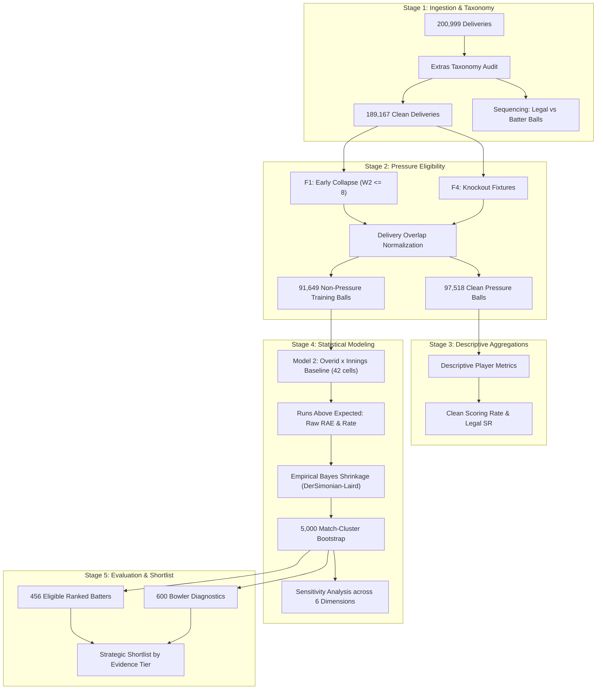

# PressurePlay

**Statistical Evaluation of High-Leverage T20 Pressure Performance (2022–2026)**<br>
*Developed for the Rajasthan Royals SupeRR Selector Season 2 Research Initiative*

---

## Table of Contents

1. [Project Overview](#project-overview)
2. [Problem Statement](#problem-statement)
3. [Objectives](#objectives)
4. [Analytical Approach & Architecture](#analytical-approach--architecture)
5. [Pressure Regime Formulations](#pressure-regime-formulations)
   - [Family 1 ($F_1$): Early-Wicket Collapse](#family-1-f_1-early-wicket-collapse)
   - [Family 4 ($F_4$): Tournament Playoff & Knockout Fixtures](#family-4-f_4-tournament-playoff--knockout-fixtures)
   - [Family Overlap Normalization ($F_1 \cup F_4$)](#family-overlap-normalization-f_1-cup-f_4)
6. [Data Processing & Delivery Taxonomy](#data-processing--delivery-taxonomy)
   - [Source Data Taxonomy & Denominators](#source-data-taxonomy--denominators)
   - [Unrecorded Variables & Feasibility Boundaries](#unrecorded-variables--feasibility-boundaries)
7. [Performance Metrics Framework](#performance-metrics-framework)
   - [Descriptive vs. Model-Based Metrics](#descriptive-vs-model-based-metrics)
   - [Runs Above Expected (RAE) Formulations](#runs-above-expected-rae-formulations)
   - [Volume vs. Rate vs. Conventional Strike Rate](#volume-vs-rate-vs-conventional-strike-rate)
8. [Statistical Methodology](#statistical-methodology)
   - [Expected Runs Baseline (Model 2)](#expected-runs-baseline-model-2)
   - [Baseline Model Comparison & Out-of-Fold Cross-Validation](#baseline-model-comparison--out-of-fold-cross-validation)
   - [Empirical Bayes (DerSimonian–Laird) Shrinkage](#empirical-bayes-dersimonianlaird-shrinkage)
   - [Match-Level Cluster Bootstrap (5,000 Replicates)](#match-level-cluster-bootstrap-5000-replicates)
   - [Systematic Sensitivity Analysis](#systematic-sensitivity-analysis)
9. [Aggregate Findings & Analytical Outputs](#aggregate-findings--analytical-outputs)
   - [Population-Level Distribution of Batter Performance](#population-level-distribution-of-batter-performance)
   - [Format-Split & Exposure Dynamics](#format-split--exposure-dynamics)
   - [Bowler Pressure Containment Diagnostics](#bowler-pressure-containment-diagnostics)
   - [Evidence Tiers & Conceptual Performance Archetypes](#evidence-tiers--conceptual-performance-archetypes)
10. [Project Architecture & Repository Structure](#project-architecture--repository-structure)
11. [Reproducibility & Execution Instructions](#reproducibility--execution-instructions)
12. [Limitations, Assumptions & Boundary Disclosures](#limitations-assumptions--boundary-disclosures)
13. [Competition Context & Acknowledgements](#competition-context--acknowledgements)

---

## Project Overview

**PressurePlay** is an end-to-end statistical modeling and diagnostics framework designed to rigorously quantify cricket player performance under verified, high-leverage Twenty20 (T20) match pressure. Built on a dataset of **200,999 delivery rows** spanning **883 scheduled matches** (867 played matches, 16 abandoned matches) across **141 registered competitions** from **2022 through 2026** (reconciling under ICC match-status regulations and board declarations to 371 Indian Premier League matches [367 played, 87,687 deliveries], 483 Men's Twenty20 Internationals [471 played, 106,582 deliveries], and 29 Other Twenty20 fixtures [29 played, 6,730 deliveries, including one unresolved fixture provisionally retained]), this repository replaces conventional aggregate averages with context-conditioned empirical baselines, small-sample Empirical Bayes shrinkage, and match-cluster bootstrap uncertainty estimation.

Conventional cricket statistics—such as raw batting average, conventional batting strike rate, and overall bowling economy—blend low-leverage run accumulations with acute game crises. PressurePlay isolates genuine pressure subsets, establishes zero-leakage non-pressure expectations, penalizes small-sample noise, and provides decision-ready strategic diagnostics without introducing artificial game-leverage weights.

---

## Problem Statement

Evaluating cricket players in high-leverage scenarios presents four fundamental statistical hurdles:

1. **Context Confounding:** Raw scoring rates vary systematically by match phase (Powerplay vs. Middle vs. Death) and innings progression. A run scored in over 4 after an early collapse represents an entirely different difficulty profile than a run scored in over 19 of a first-innings baseline match.
2. **Small-Sample Distortion:** High-pressure situations (such as early-wicket collapses or playoff matches) constitute a fraction of a player's total career deliveries. Raw rate metrics over 30–100 balls over-index heavily on noise, inflating extreme performances.
3. **Cluster-Correlated Sampling Variance:** Deliveries within a single match are not independent; they share identical pitch conditions, boundary dimensions, weather, opponent quality, and game state. Standard independent-delivery confidence intervals underestimate sampling variance by failing to account for match clustering.
4. **Source Data Missingness & Irregular Extras:** Public ball-by-ball records frequently lack verified delivery-by-delivery required run rates, live team targets, and official +1 penalty runs on illegal extras (wides and no-balls). Unchecked analyses risk generating mathematically invalid metrics.

---

## Objectives

- **Isolate Feasible Pressure Regimes:** Formulate objective, mathematically verifiable pressure delivery subsets grounded solely in verifiable source attributes.
- **Construct Zero-Leakage Baselines:** Train empirical expected-runs models on clean deliveries from non-pressure situations, preventing target contamination.
- **Separate True Talent from Sample Noise:** Formulate an Empirical Bayes shrinkage architecture using the DerSimonian–Laird estimator to pull low-exposure outliers toward population priors.
- **Quantify Sampling Uncertainty:** Implement a vectorized match-level cluster bootstrap (5,000 resamples) to compute empirical 95% confidence intervals preserving intra-match correlation.
- **Deliver Decision-Ready Diagnostics:** Classify qualified players into explicit evidence tiers to guide strategic evaluation without overstating certainty.

---

## Analytical Approach & Architecture

The analytical pipeline is structured into five sequential, audited stages:



---

## Pressure Regime Formulations

### Family 1 ($F_1$): Early-Wicket Collapse
- **Definition:** The second batting wicket ($W_2$) of an innings falls at or before delivery over index 8 ($\text{overid}(W_2) \le 8$).
- **Window Scope:** Extends from $W_2$ inclusive through the final delivery of the innings.
- **Empirical Volume:** Captures **95,138 clean deliveries** across 100,879 F1-eligible deliveries. When broken down by overlap with $F_4$ playoff fixtures, this comprises **93,110 $F_1$-only clean deliveries** and **2,028 overlapping clean deliveries** (where an early collapse occurred during a playoff knockout match).
- **Sensitivity Cohorts:** Evaluated against Alt 1A Complete-60 (first 60 legal balls following $W_2$) and varying threshold cutoffs ($W_2 \le 6$ and $W_2 \le 10$).

### Family 4 ($F_4$): Tournament Playoff & Knockout Fixtures
- **Definition:** All deliveries across both innings of tournament playoff fixtures (Eliminators, Qualifiers, Semi-Finals, and Finals).
- **Empirical Volume:** 20 official playoff matches across the 2022–2026 IPL seasons, encompassing **4,408 clean deliveries** across 4,667 total deliveries (comprising **2,380 $F_4$-only clean deliveries** and **2,028 overlapping clean deliveries** with $F_1$).

### Family Overlap Normalization ($F_1 \cup F_4$)
When an innings satisfies both $F_1$ (early collapse) and occurs in an $F_4$ (knockout match), deliveries within the intersection belong to both families. To avoid double-counting while preserving overall exposure:

$$w_k(d) = \frac{\text{raw}\_w_k}{\sum_{j \in \text{active}(d)} \text{raw}\_w_j}$$

With raw weights $\text{raw\_w}_1 = 1.0$ and $\text{raw\_w}_4 = 0.5$:
- **$F_1$-Only Delivery (93,110 clean balls):** $w_1 = 1.0 / 1.0 = 1.0$
- **$F_4$-Only Delivery (2,380 clean balls):** $w_4 = 0.5 / 0.5 = 1.0$
- **Overlap Delivery ($F_1 \cap F_4$, 2,028 clean balls):** $w_1 = 1.0 / 1.5 = 2/3$, $w_4 = 0.5 / 1.5 = 1/3$
- **Combined Cohort Union ($F_1 \cup F_4$):** Exactly $93,110 + 2,380 + 2,028 = \mathbf{97,518}$ clean pressure deliveries ($w_1(d) + w_4(d) = 1.0$ for every delivery in the union).
- **Total Clean Volume Reconciliation:** Total $F_1$ clean deliveries ($93,110 + 2,028 = \mathbf{95,138}$) and total $F_4$ clean deliveries ($2,380 + 2,028 = \mathbf{4,408}$) reconcile precisely with Stage 3 descriptive records without double-counting.

> **Important:** The 2:1 ratio operates **only on overlapping deliveries**. Standalone $F_4$-only deliveries contribute full weight 1.0.

---

## Data Processing & Delivery Taxonomy

### Source Data Taxonomy & Denominators

The raw delivery dataset comprises 200,999 records across 141 competitions (2022–2026). Delivery attributes were categorized into a strict taxonomy based on the stored `extras_type`:

| Stored `extras_type` | Delivery Count | Percentage | Batter Attribution | Bowler Attribution | Notes |
|---|:---:|:---:|---|---|---|
| `'None'` (string) | 189,167 | 94.11% | Credited to striker | Clean runs conceded | Clean delivery off the bat |
| `'wide'` | 7,714 | 3.84% | Excluded | Excluded from legal | +1 penalty unrecorded |
| `'legbyes'` | 2,748 | 1.37% | Excluded | Legal ball; 0 clean runs | Runs credited to team |
| `'Overstep'` (No-ball) | 576 | 0.29% | Runs off bat credited | Excluded from legal | +1 penalty unrecorded |
| `'byes'` | 529 | 0.26% | Excluded | Legal ball; 0 clean runs | Runs credited to team |
| `'other'` | 264 | 0.13% | Excluded | Excluded | Undocumented source taxonomy |
| `'Penalty'` | 1 | <0.01% | Excluded | Excluded | Excluded from primary metrics |

### Unrecorded Variables & Feasibility Boundaries

Auditing the raw files established strict boundaries on what could and could not be mathematically calculated:

1. **Unrecorded Penalty Extras:** Source CSVs omit the mandatory +1 run penalty for the 7,714 wides and 576 no-balls. Bye and leg-bye records store `runs == 0` with the actual extra omitted. As a result, **official bowler economy rates, official batter strike rates, and official team totals cannot be reconstructed.**
2. **Clean Runs & Deliveries:** All primary batting and baseline analyses strictly evaluate clean deliveries off the bat (`extras_type == 'None'`).
3. **Clean Bowling Containment:** Bowlers are evaluated strictly via **Clean Containment Rate** ($RC_{\text{clean}} / BB_{\text{clean}}$) and legal balls bowled per credited wicket ($BB_{\text{legal}} / \text{Wickets}$).
4. **Excluded Families (F2 & F3):** Run Chase Pressure ($F_2$) and Required Run Rate Pressure ($F_3$) were excluded from the primary model due to absent delivery-by-delivery target scoreboards and Duckworth-Lewis-Stern (DLS) revisions in the source data.

---

## Performance Metrics Framework

### Descriptive vs. Model-Based Metrics

The framework enforces a strict conceptual separation between descriptive observations and statistical model outputs:

- **Descriptive Statistics:** Observed clean runs ($Y_p$), clean balls faced ($n_p$), clean scoring rate ($Y_p / n_p$), credited wickets, and legal balls per credited wicket.
- **Model-Based Estimates:** Expected clean runs ($E_p$), Raw Runs Above Expected ($\text{Raw RAE}_p = Y_p - E_p$), Shrunk Rate Above Expected ($\theta_p^*$), and Cumulative Shrunk Runs Above Expected ($\text{Shrunk RAE}_p$).

### Runs Above Expected (RAE) Formulations

For batter $p$ across pressure clean deliveries $i \in \mathcal{D}_p$:

$$\text{Clean Balls Faced: } n_p = \sum_{i \in \mathcal{D}_p} w_i, \quad \text{Observed Runs: } Y_p = \sum_{i \in \mathcal{D}_p} w_i Y_i, \quad \text{Expected Runs: } E_p = \sum_{i \in \mathcal{D}_p} w_i \hat{Y}_i$$

$$\text{Raw RAE}_p = Y_p - E_p \quad (\text{runs accumulated above baseline})$$

$$\text{Raw Rate Above Expected: } \theta_p = \frac{Y_p - E_p}{n_p} \quad (\text{runs per clean ball above baseline})$$

### Volume vs. Rate vs. Conventional Strike Rate

- **Cumulative Shrunk RAE ($\text{Shrunk RAE}_p = n_p \cdot \theta_p^*$):** An **aggregate volume metric** expressed in total runs. It measures total net run production above baseline across the historical sample. **It is not a standardized talent rating, per-delivery efficiency index, or runs-above-replacement metric.** Because it scales directly with clean balls faced ($n_p$), high-exposure players accumulate larger absolute cumulative totals than low-exposure players with similar or higher per-ball rates.
- **Shrunk Rate Above Expected ($\theta_p^*$):** A **rate metric** expressed in runs per clean ball above expectation, isolating per-delivery efficiency after attenuating small-sample noise.
- **Clean Scoring Rate ($Y_p / n_p$):** Observed runs per clean ball. **This is distinct from conventional batting strike rate**, which is scaled per 100 balls and incorporates extras off no-balls.

---

## Statistical Methodology

### Expected Runs Baseline (Model 2)

Player execution is evaluated against an empirical expectation baseline fitted on **91,649 total non-pressure clean training deliveries** (`f1_primary == False` and `f4_knockout == False`), decomposing into **91,623 standard-over non-pressure clean deliveries** (IPL: 42,063, T20I: 46,798, Other T20: 2,762) and **26 Super Over non-pressure clean deliveries** (IPL: 11, T20I: 8, Other T20: 7; summing to competition totals of IPL: 42,074, T20I: 46,806, Other T20: 2,769):

- **Feature Space:** Discrete interaction of delivery over index (`overid` in 1..20) and match innings (1..4), creating **42 unconstrained empirical lookup cells** (40 standard overs across innings 1 and 2, plus 2 sparse Super Over cells).
- **Zero Leakage:** Pressure delivery outcomes never inform their own expected baseline.
- **Non-Parametric Specification:** Lookups are unconstrained empirical cell-by-cell means without imposing parametric functional forms or monotonic constraints.
- **Super Over Support & Accounting:** Across the 2022–2026 dataset, 38 total Super Over attempts occurred across 6 matches. 6 non-clean deliveries (wides/extras) are excluded because they fail the clean-delivery definition. Of the 32 clean Super Over deliveries, 6 are excluded from baseline training because they are $F_1$ pressure deliveries (all in innings 3; 0 in $F_4$), leaving exactly 26 non-pressure clean deliveries (15 in innings 3, 11 in innings 4). While the 6 Super Over pressure deliveries map directly to cell `(1, 3)` without fallback, Super Over baseline estimates are substantially less reliable than standard innings 1–2 estimates.

### Baseline Model Comparison & Out-of-Fold Cross-Validation

Candidate baseline models were evaluated using 5-fold match-grouped cross-validation across the 91,649 non-pressure clean deliveries:

| Baseline Model | Feature Structure | Parameters / Cells | Out-of-Fold MAE | Out-of-Fold RMSE | Calibration Slope | Calibration Intercept | Selection Verdict |
|---|---|:---:|:---:|:---:|:---:|:---:|---|
| **Model 0 (Global Mean)** | Constant non-pressure mean | 1 | 1.4282 | 1.8032 | *Undefined* | *Undefined* | Underfits; ignores phase |
| **Model 1 (Phase $\times$ Innings)** | Powerplay / Middle / Death $\times$ Innings | 6 | 1.4239 | 1.8003 | 0.9419 | 0.0863 | Coarse over-aggregation |
| **Model 2 (Overid $\times$ Innings)** | Discrete over index (1..20) $\times$ Innings (1..4) | **42** | **1.4131** | **1.7930** | **0.9439** | **0.0832** | **Selected Primary Baseline** |
| **Model 3 (Over $\times$ Inn $\times$ Wickets)** | Over index $\times$ Innings $\times$ Wickets fallen | 160+ | 1.4088 | 1.7907 | 0.8754 | 0.1857 | Unreliable (27% support deficit) |
| **Model 4 (Over $\times$ Inn $\times$ Wkt $\times$ Bowler)** | Over/Inn/Wickets + Bowler quality proxy | Continuous | 1.4048 | 1.7927 | 0.7116 | 0.4324 | Overfits; poor calibration |

*Note: Calibration slope and intercept are mathematically undefined for Model 0 due to zero variance in constant predictions.*

Model 2 achieved the optimal balance of out-of-fold calibration (slope = 0.9439, intercept = 0.0832) and error minimization while avoiding support deficits.

### Empirical Bayes (DerSimonian–Laird) Shrinkage

To separate genuine situational scoring performance from small-sample fluctuation, player excess rate differences $\theta_p$ were regularized using the DerSimonian–Laird (DL) random-effects estimator:

$$\theta_p \mid \theta_p^{\text{true}} \sim \mathcal{N}\left(\theta_p^{\text{true}}, v_p\right), \quad v_p = \frac{\sigma^2}{n_p}$$

$$\theta_p^{\text{true}} \sim \mathcal{N}\left(\mu, \tau^2\right)$$

- **Prior Mean ($\mu$):** Measures overall baseline scoring depression under pressure (-0.1872 runs/ball for Composite; -0.1942 runs/ball for $F_1$ Primary).
- **True Talent Variance ($\tau^2$):** Between-player variance in true rate skill (0.041989 for Composite, $\tau \approx 0.205$ runs/ball).
- **Delivery Residual Variance ($\sigma^2$):** Pooled residual variance (2.8443 for Composite, 2.8294 for $F_1$ Primary).
- **Sampling Variance Assumption:** $v_p = \sigma^2 / n_p$ is a model-based, independent-delivery formulation assuming conditional independence across balls faced. It does not adjust for intra-match clustering.
- **Shrinkage Weight & Estimate:**
  $$B_p = \frac{v_p}{\tau^2 + v_p}, \quad \theta_p^* = (1 - B_p)\theta_p + B_p \mu, \quad \text{Shrunk RAE}_p = n_p \cdot \theta_p^*$$

Batters with $n_p \ge 150$ clean balls retain $\approx 70\text{--}90\%$ of their raw deviation ($B_p < 0.30$), while low-exposure batters experience greater estimation uncertainty and stronger shrinkage toward the population prior.

### Match-Level Cluster Bootstrap (5,000 Replicates)

- **Cluster Resampling:** Resampling with replacement was conducted at the `match_id` cluster level across **745 match clusters** (5,000 resamples), fully preserving delivery-to-delivery correlation, opponent strength, and intra-match context.
- **Conditional Scope of Uncertainty:** Bootstrap confidence intervals are **strictly conditional** on the fixed Model 2 baseline predictions and fixed Empirical Bayes prior hyperparameters ($\mu, \tau^2$). They reflect first-order sampling variation in player outcomes given match clustering; they do not represent full Bayesian posterior intervals.
- **Important Distinction:** The cluster bootstrap evaluates sampling variation for player confidence intervals; it **does not retroactively alter the independent-delivery variance assumption ($v_p = \sigma^2 / n_p$) in the shrinkage point formula itself**.
- **Nominal Significance:** A player's divergence is nominally statistically significant ($p < 0.05$) only if their individual 95% bootstrap CI strictly excludes zero. **No multiple-testing correction was applied across the 456 eligible batters**; these intervals represent unadjusted, exploratory evidence.

### Systematic Sensitivity Analysis

Sensitivity analysis evaluated the stability of player rankings across 6 methodological dimensions:

| Comparison Dimension | Batters Evaluated | Spearman $\rho$ | Kendall $\tau$ | Mean Absolute Rank Shift | Top-10 Overlap |
|---|:---:|:---:|:---:|:---:|:---:|
| **Window Definition:** $F_1$ Primary vs. Alt 1A Complete-60 | 322 | 0.7847 | 0.6350 | 38.02 | 60.0% |
| **Window Subsets:** Alt 1A Complete-60 vs. Alt 1A All | 322 | 0.9628 | 0.8746 | 13.16 | 70.0% |
| **Collapse Cutoff:** $W_2 \le 8$ vs. $W_2 \le 6$ | 415 | 0.9424 | 0.8315 | 23.57 | 60.0% |
| **Collapse Cutoff:** $W_2 \le 8$ vs. $W_2 \le 10$ | 453 | 0.9769 | 0.8909 | 17.43 | 100.0% |
| **Overlap Weighting:** Normalized Composite vs. $F_1$ Primary | 453 | 0.9872 | 0.9644 | 5.97 | 100.0% |
| **Overlap Weighting:** Normalized Composite vs. Unweighted Union | 456 | 1.0000 | 1.0000 | 0.00 | 100.0% |
| **Baseline Specification:** Model 2 vs. Model 1 (Phase) | 453 | 0.9830 | 0.9236 | 13.07 | 90.0% |
| **Baseline Specification:** Model 2 vs. Model 0 (Global Mean) | 453 | 0.9351 | 0.8450 | 25.24 | 80.0% |
| **Baseline Specification:** Model 2 vs. Model 3 (Wickets Fallen)* | 453 | 0.6393 | 0.5206 | 80.56 | 60.0% |
| **Shrinkage Effect:** Shrunk RAE vs. Raw RAE ($F_1$ Primary) | 453 | 0.9562 | 0.8344 | 27.39 | 100.0% |

*\*Model 3 suffers from a 27.0% support deficit in non-pressure data and was excluded from model selection.*

---

## Aggregate Findings & Analytical Outputs

### Population-Level Distribution of Batter Performance

Across the dataset universe, **854 total batters** faced deliveries under high-leverage match conditions. Applying the minimum exposure threshold of $n_p \ge 30$ clean balls identified **456 qualified batters** eligible for formal ranking and evidence-tier evaluation (the remaining 398 batters had insufficient exposure, $n_p < 30$).

Evaluating player performance against the Model 2 baseline reveals the acute scoring depression characteristic of early top-order collapse:

- **Empirical Population Shift:** Across all 456 qualified batters, the mean Shrunk Runs Above Expected (RAE) was **-31.46 runs** (median: **-22.00 runs**, standard deviation: **41.46 runs**, interquartile range: **-43.44 to -10.40 runs**). This empirical distribution confirms that early-collapse match states suppress scoring across the broader batting population relative to standard non-pressure conditions.
- **Raw vs. Shrunk Divergence:** The unregularized Raw RAE across qualified batters displayed a mean of **-34.67 runs** (median: **-29.55 runs**, standard deviation: **46.42 runs**, interquartile range: **-52.56 to -13.36 runs**). Empirical Bayes shrinkage successfully pulled noisy extreme rates toward the population prior ($\mu = -0.1872$ runs/ball in the composite cohort), stabilizing player evaluations without distorting established high-exposure production.
- **Evidence Tier Breakdown:**
  - **`STRONG_POSITIVE_EVIDENCE` ($n = 2$, 0.4% of qualified batters):** Only 2 of the 456 qualified batters demonstrated statistically supported positive divergence where the individual unadjusted 95% bootstrap confidence interval strictly excluded zero.
  - **`PROMISING_UNCERTAIN` ($n = 30$, 6.6% of qualified batters):** 30 batters achieved positive point estimates above baseline expectations ($\text{Shrunk RAE} > 0$), but their unadjusted 95% match-level cluster bootstrap confidence intervals spanned zero.
  - **`BELOW_EXPECTATION_UNCERTAIN` ($n = 167$, 36.6% of qualified batters):** 167 batters recorded negative point estimates relative to Model 2 baseline expectations ($\text{Shrunk RAE} < 0$), with 95% confidence intervals spanning zero.
  - **`STRONG_NEGATIVE_EVIDENCE` ($n = 257$, 56.4% of qualified batters):** 257 batters recorded negative point estimates with unadjusted 95% confidence intervals strictly below zero ($p < 0.05$).
  - **`INSUFFICIENT_EXPOSURE` ($n = 398$):** Batters with $n_p < 30$ clean balls, where high sampling variance produces stronger shrinkage, pulling estimates heavily toward the population prior and precluding reliable individual evaluation.

### Format-Split & Exposure Dynamics

Investigating competition splits (domestic IPL vs. international T20I) across player careers yields three key methodological takeaways:

1. **Domestic Volume Dominance:** Because IPL matches provide the highest concentration of early top-order collapse deliveries within the 2022–2026 window, composite player standing is heavily anchored in domestic IPL exposure.
2. **Consistency Across Observed Formats:** For batters displaying substantial negative baseline divergence under early collapses, format-specific sub-splits indicate consistent sub-baseline scoring rates across both domestic IPL and international T20I appearances. Restricting to domestic-only data alters absolute run volume but does not reverse negative rate differentials.
3. **Absence of Counterfactual Projections:** International retirement halts further T20I delivery accumulation in historical records. Observed splits describe actual historical performance within the dataset and **cannot establish counterfactual rankings or quantify the hypothetical impact of unplayed fixtures**.

### Bowler Pressure Containment Diagnostics

A total of **600 bowlers** were evaluated in the composite pressure cohort ($F_1 \cup F_4$) across the full multi-competition master dataset (141 registered competitions: 5 IPL editions, 134 T20I competitions, 2 mixed-status developmental tournaments, reconciling under ICC regulations and board declarations to 371 scheduled IPL matches [367 played, 87,687 deliveries], 483 scheduled T20Is [471 played, 106,582 deliveries], and 29 Other T20 fixtures [29 played, 6,730 deliveries]; 883 scheduled matches, 867 played matches, 16 abandoned matches, 200,999 total deliveries; January 22, 2022 – November 1, 2026). Because unrecorded penalty runs prevent computing official economy rates, bowling analysis evaluates clean containment ($RC_{\text{clean}} / BB_{\text{clean}}$) and legal balls bowled per credited wicket ($BB_{\text{legal}} / \text{Wickets}$):

- **Containment Distribution:** Across all 600 bowlers, the mean clean containment rate was **1.42 clean runs conceded per clean ball** (median: **1.38**, standard deviation: **0.47**, interquartile range: **1.19 to 1.58 runs/ball**).
- **Observed Bowling Performance Profiles:** Across the 600 bowlers evaluated under pressure, empirical performance reflects distinct distributions across clean containment ($RC_{\text{clean}} / BB_{\text{clean}}$) and dismissal frequency ($BB_{\text{legal}} / \text{Wickets}$):
  - *Low Clean Containment Profiles:* Bowlers conceding clean runs at rates below the population median of 1.38 clean runs/ball, accumulating negative clean run residuals relative to Model 2 baseline expectations.
  - *High Dismissal Frequency Profiles:* Bowlers recording low legal balls bowled per credited wicket under pressure, observed across a spectrum of clean containment rates.

### Evidence Tiers & Conceptual Performance Archetypes

To illustrate how the multi-stage framework operates without publishing proprietary or player-specific rankings, the evidence-tier taxonomy categorizes players based on empirical point estimates, shrinkage regularization, clean exposure volume, and cluster bootstrap uncertainty. These archetypes represent conceptual interpretations of statistical evidence tiers rather than direct measurements of intrinsic player ability, tactical intent, or unmeasured outcomes such as wicket preservation:

- **Nominally Significant Positive Evidence (`STRONG_POSITIVE_EVIDENCE`):**
  - *Statistical Profile:* Cumulative Shrunk RAE $> 0$ and shrunk rate differential $\theta_p^* > 0$, indicating clean scoring performance above Model 2 baseline expectations in the weighted composite ($F_1 \cup F_4$) cohort.
  - *Exposure & Regularization:* High clean-ball exposure ($n_p \ge 30$) compresses sampling variance ($v_p \ll \tau^2$), yielding low shrinkage factors ($B_p < 0.20$ among qualified players in this tier) so regularized estimates remain anchored near observed rate differentials.
  - *Bootstrap Uncertainty:* The unadjusted 95% match-level cluster bootstrap confidence interval strictly excludes zero (lower bound $> 0$).

- **Positive Point Estimate with Bootstrap Overlap (`PROMISING_UNCERTAIN`):**
  - *Statistical Profile:* Cumulative Shrunk RAE $> 0$ and shrunk rate differential $\theta_p^* > 0$, scoring above Model 2 baseline expectations.
  - *Exposure & Regularization:* Moderate exposure where Empirical Bayes shrinkage pulls raw rates toward the population prior ($\mu = -0.1872$ runs/ball) according to player-specific sampling variance ($v_p = \sigma^2 / n_p$).
  - *Bootstrap Uncertainty:* The 95% match-level cluster bootstrap confidence interval spans zero (lower bound $\le 0$), indicating that observed positive sample divergence does not achieve nominal statistical significance under match-level clustering.

- **Negative Point Estimate with Bootstrap Overlap (`BELOW_EXPECTATION_UNCERTAIN`):**
  - *Statistical Profile:* Cumulative Shrunk RAE $< 0$ and shrunk rate differential $\theta_p^* < 0$, scoring below Model 2 baseline expectations.
  - *Exposure & Regularization:* Point estimates regularized toward the population prior ($\mu = -0.1872$ runs/ball) based on available exposure.
  - *Bootstrap Uncertainty:* The 95% match-level cluster bootstrap confidence interval spans zero (upper bound $\ge 0$), meaning the observed scoring deficit does not reach nominal statistical significance under match-level cluster resampling.

- **Nominally Significant Negative Evidence (`STRONG_NEGATIVE_EVIDENCE`):**
  - *Statistical Profile:* Cumulative Shrunk RAE $< 0$ and shrunk rate differential $\theta_p^* < 0$, scoring below Model 2 baseline expectations.
  - *Exposure & Regularization:* Sufficient exposure ($n_p \ge 30$) yielding a regularized point estimate below baseline.
  - *Bootstrap Uncertainty:* The unadjusted 95% match-level cluster bootstrap confidence interval strictly excludes zero (upper bound $< 0$, $p < 0.05$), reflecting statistically supported negative divergence under match-level clustering.

- **Insufficient Exposure (`INSUFFICIENT_EXPOSURE`):**
  - *Statistical Profile:* Fewer than 30 clean balls faced under pressure ($n_p < 30$), where small sample sizes produce high sampling variance ($v_p$), greater estimation uncertainty, and stronger shrinkage.
  - *Exposure & Regularization:* Point estimates are pulled heavily toward the population prior ($\mu = -0.1872$ runs/ball), precluding reliable individual evaluation.

---

## Project Architecture & Repository Structure

```
PressurePlay/
├── .gitignore                                  # Git exclusion rules for raw data & derived outputs
├── README.md                                   # Repository technical documentation
│
├── audit_pressure_eligibility.py               # Stage 2: Audits delivery pressure eligibility
├── build_stage3.py                             # Stage 3: Generates descriptive batting/bowling metrics
├── build_stage4.py                             # Stage 4: Fits Model 2 baseline, EB shrinkage, bootstrap
├── build_final.py                              # Stage 5: Assembles leaderboards, diagnostics & reports
├── build_validation.py                         # Stage 5: End-to-end validation & reconciliation suite
│
├── outputs/
│   ├── descriptive/
│   │   └── metric_definitions.json             # V5 JSON specification of all metric formulas
│   ├── statistical/
│   │   └── stage4_methodology.md               # Mathematical specification of Stage 4 baseline & EB
│   └── final/
│       ├── final_methodology.md                # Comprehensive technical methodology across all stages
│       └── final_project_report.md             # Decision-ready executive evaluation report
```

*Note: Raw source datasets (`data/`), delivery-level eligibility CSVs, player-level rankings, and validation artifacts are excluded from version control via `.gitignore` to preserve data integrity and privacy.*

---

## Reproducibility & Execution Instructions

### Prerequisites & Dependencies

The codebase requires **Python 3.10+** and relies strictly on standard numerical and scientific libraries. Verified package requirements:

```text
numpy>=1.24.0
pandas>=2.0.0
scipy>=1.10.0
```

Install dependencies:
```bash
pip install numpy pandas scipy
```

### Execution Pipeline

The analytical pipeline is executed sequentially. With the raw data files placed in `data/data_pack/`:

```bash
# 1. Audit and generate delivery-level pressure eligibility flags
python audit_pressure_eligibility.py

# 2. Build descriptive aggregations across player splits and cohorts
python build_stage3.py

# 3. Fit Model 2 baseline, compute Empirical Bayes shrinkage and 5,000-replicate bootstrap
python build_stage4.py

# 4. Synthesize final leaderboards, bowler diagnostics, and reports
python build_final.py

# 5. Run end-to-end automated reconciliation and validation checks
python build_validation.py
```

---

## Limitations, Assumptions & Boundary Disclosures

1. **Historical Time Window (2022–2026):** All metrics reflect delivery performance strictly from 2022 through 2026 across the supplied competitions. **This is not an all-time IPL player ranking.**
2. **Conditional Bootstrap Intervals:** The 5,000 match-cluster bootstrap intervals (resampled with replacement at the `match_id` cluster level with fixed seed 123) hold Model 2 baseline predictions and Empirical Bayes hyperparameters ($\mu, \tau^2$) fixed. They evaluate sampling variation in player outcomes given match clustering, not full posterior predictive distributions.
3. **Unadjusted Multiple Testing:** Significance flags reflect individual unadjusted 95% percentile confidence intervals. Across 456 eligible batters, individual tests are subject to family-wise false discovery risk.
4. **Exposure-Dependent Volume vs. Consistency:** Cumulative Shrunk RAE ($n_p \cdot \theta_p^*$) scales with balls faced. It reflects cumulative historical scoring value added above baseline, not a standardized rate differential, game-to-game consistency metric, or failure-avoidance index.
5. **Scoring Residual Framework Boundaries:** The scoring residual framework measures runs scored above or below a phase/over-based expectation. It does not fully capture wicket preservation, match-win probability, or tactical value under collapse conditions.
6. **Innings-Level Qualification Scope:** Positive innings frequency evaluates strictly qualifying pressure match-innings where a batter faced $\ge 1$ clean pressure delivery; it does not represent the proportion of all career matches in which a player performed well.
7. **No Causal Inference:** The models identify empirical associations within observed historical states. They do not predict future performance, model opposition counter-strategies, or establish players' tactical intentions.
8. **Unavailable Match Context:** Run Chase Pressure ($F_2$) and Required Run Rate ($F_3$) could not be included due to missing delivery-level target scoreboards in the source data. Bowler analysis is restricted to clean containment due to unrecorded extras penalty runs.
9. **Population Universe Accounting:** The source universe comprises 1,217 registered tournament squad members, 1,082 starting XI players, and 2 registered substitute match batters (Player IDs 36153 and 39444), yielding 1,084 total unique on-field match participants and 133 registered squad members who did not participate in the analyzed matches.

---

## Competition Context & Acknowledgements

This research was developed for the **Rajasthan Royals SupeRR Selector Season 2** competition. The analytical methodology, baseline models, shrinkage estimators, and validation scripts were engineered to provide an empirical, mathematically grounded foundation for franchise player evaluation and strategic decision-making.
