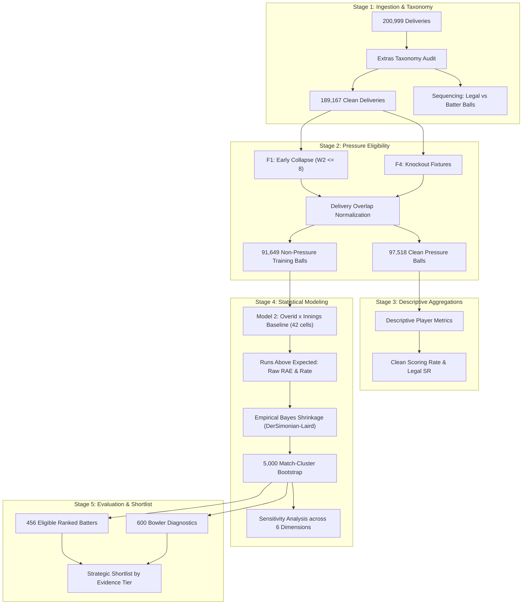

# PressurePlay

**Statistical Evaluation of High-Leverage T20 Pressure Performance (2022–2026)**<br>
*Developed for the Rajasthan Royals SupeRR Selector Season 2 Research Initiative*

---

## Table of Contents

1. [Project Overview](#project-overview)
2. [Problem Statement](#problem-statement)
3. [Objectives](#objectives)
4. [Analytical Approach & Architecture](#analytical-approach--architecture)
5. [Pressure Regime Formulations](#pressure-regime-formulations)
   - [Family 1 ($F_1$): Early-Wicket Collapse](#family-1-f_1-early-wicket-collapse)
   - [Family 4 ($F_4$): Tournament Playoff & Knockout Fixtures](#family-4-f_4-tournament-playoff--knockout-fixtures)
   - [Family Overlap Normalization ($F_1 \cup F_4$)](#family-overlap-normalization-f_1-cup-f_4)
6. [Data Processing & Delivery Taxonomy](#data-processing--delivery-taxonomy)
   - [Source Data Taxonomy & Denominators](#source-data-taxonomy--denominators)
   - [Unrecorded Variables & Feasibility Boundaries](#unrecorded-variables--feasibility-boundaries)
7. [Performance Metrics Framework](#performance-metrics-framework)
   - [Descriptive vs. Model-Based Metrics](#descriptive-vs-model-based-metrics)
   - [Runs Above Expected (RAE) Formulations](#runs-above-expected-rae-formulations)
   - [Volume vs. Rate vs. Conventional Strike Rate](#volume-vs-rate-vs-conventional-strike-rate)
8. [Statistical Methodology](#statistical-methodology)
   - [Expected Runs Baseline (Model 2)](#expected-runs-baseline-model-2)
   - [Baseline Model Comparison & Out-of-Fold Cross-Validation](#baseline-model-comparison--out-of-fold-cross-validation)
   - [Empirical Bayes (DerSimonian–Laird) Shrinkage](#empirical-bayes-dersimonianlaird-shrinkage)
   - [Match-Level Cluster Bootstrap (5,000 Replicates)](#match-level-cluster-bootstrap-5000-replicates)
   - [Systematic Sensitivity Analysis](#systematic-sensitivity-analysis)
9. [Key Findings & Analytical Outputs](#key-findings--analytical-outputs)
   - [Batter Leaderboard Highlights](#batter-leaderboard-highlights)
   - [Sub-Baseline Scoring Diagnostics](#sub-baseline-scoring-diagnostics)
   - [Bowler Pressure Diagnostics](#bowler-pressure-diagnostics)
   - [Evidence Tiers & Shortlist Categorization](#evidence-tiers--shortlist-categorization)
10. [Project Architecture & Repository Structure](#project-architecture--repository-structure)
11. [Reproducibility & Execution Instructions](#reproducibility--execution-instructions)
12. [Limitations, Assumptions & Boundary Disclosures](#limitations-assumptions--boundary-disclosures)
13. [Competition Context & Acknowledgements](#competition-context--acknowledgements)

---

## Project Overview

**PressurePlay** is an end-to-end statistical modeling and diagnostics framework designed to rigorously quantify cricket player performance under verified, high-leverage Twenty20 (T20) match pressure. Built on a dataset of **200,999 delivery rows** spanning **883 matches** from **2022 through 2026** (comprising 371 Indian Premier League matches, 482 Men's Twenty20 Internationals, and 30 emerging Asian tournament fixtures), this repository replaces conventional aggregate averages with context-conditioned empirical baselines, small-sample Empirical Bayes shrinkage, and match-cluster bootstrap uncertainty estimation.

Conventional cricket statistics—such as raw batting average, conventional batting strike rate, and overall bowling economy—blend low-leverage run accumulations with acute game crises. PressurePlay isolates genuine pressure subsets, establishes zero-leakage non-pressure expectations, penalizes small-sample noise, and provides decision-ready strategic diagnostics without introducing artificial game-leverage weights.

---

## Problem Statement

Evaluating cricket players in high-leverage scenarios presents four fundamental statistical hurdles:

1. **Context Confounding:** Raw scoring rates vary systematically by match phase (Powerplay vs. Middle vs. Death) and innings progression. A run scored in over 4 after an early collapse represents an entirely different difficulty profile than a run scored in over 19 of a first-innings baseline match.
2. **Small-Sample Distortion:** High-pressure situations (such as early-wicket collapses or playoff matches) constitute a fraction of a player's total career deliveries. Raw rate metrics over 30–100 balls over-index heavily on noise, inflating extreme performances.
3. **Cluster-Correlated Sampling Variance:** Deliveries within a single match are not independent; they share identical pitch conditions, boundary dimensions, weather, opponent quality, and game state. Standard independent-delivery confidence intervals underestimate sampling variance by failing to account for match clustering.
4. **Source Data Missingness & Irregular Extras:** Public ball-by-ball records frequently lack verified delivery-by-delivery required run rates, live team targets, and official +1 penalty runs on illegal extras (wides and no-balls). Unchecked analyses risk generating mathematically invalid metrics.

---

## Objectives

- **Isolate Feasible Pressure Regimes:** Formulate objective, mathematically verifiable pressure delivery subsets grounded solely in verifiable source attributes.
- **Construct Zero-Leakage Baselines:** Train empirical expected-runs models on clean deliveries from non-pressure situations, preventing target contamination.
- **Separate True Talent from Sample Noise:** Formulate an Empirical Bayes shrinkage architecture using the DerSimonian–Laird estimator to pull low-exposure outliers toward population priors.
- **Quantify Sampling Uncertainty:** Implement a vectorized match-level cluster bootstrap (5,000 resamples) to compute empirical 95% confidence intervals preserving intra-match correlation.
- **Deliver Decision-Ready Diagnostics:** Classify qualified players into explicit evidence tiers to guide strategic evaluation without overstating certainty.

---

## Analytical Approach & Architecture

The analytical pipeline is structured into five sequential, audited stages:



---

## Pressure Regime Formulations

### Family 1 ($F_1$): Early-Wicket Collapse
- **Definition:** The second batting wicket ($W_2$) of an innings falls at or before delivery over index 8 ($\text{overid}(W_2) \le 8$).
- **Window Scope:** Extends from $W_2$ inclusive through the final delivery of the innings.
- **Empirical Volume:** Captures 93,110 clean deliveries where an early top-order failure forced middle- and lower-order batters into immediate crisis management.
- **Sensitivity Cohorts:** Evaluated against Alt 1A Complete-60 (first 60 legal balls following $W_2$) and varying threshold cutoffs ($W_2 \le 6$ and $W_2 \le 10$).

### Family 4 ($F_4$): Tournament Playoff & Knockout Fixtures
- **Definition:** All deliveries across both innings of tournament playoff fixtures (Eliminators, Qualifiers, Semi-Finals, and Finals).
- **Empirical Volume:** 20 official playoff matches across the 2022–2026 IPL seasons, encompassing 4,408 clean deliveries.

### Family Overlap Normalization ($F_1 \cup F_4$)
When an innings satisfies both $F_1$ (early collapse) and occurs in an $F_4$ (knockout match), deliveries within the intersection belong to both families. To avoid double-counting while preserving overall exposure:

$$w_k(d) = \frac{\text{raw}\_w_k}{\sum_{j \in \text{active}(d)} \text{raw}\_w_j}$$

With raw weights $\text{raw\_w}_1 = 1.0$ and $\text{raw\_w}_4 = 0.5$:
- **$F_1$-Only Delivery (93,110 clean balls):** $w_1 = 1.0 / 1.0 = 1.0$
- **$F_4$-Only Delivery (2,380 clean balls):** $w_4 = 0.5 / 0.5 = 1.0$
- **Overlap Delivery ($F_1 \cap F_4$, 2,028 clean balls):** $w_1 = 1.0 / 1.5 = 2/3$, $w_4 = 0.5 / 1.5 = 1/3$
- **Combined Weight:** $w_1(d) + w_4(d) = 1.0$ for every delivery in the union (97,518 clean deliveries).

> **Important:** The 2:1 ratio operates **only on overlapping deliveries**. Standalone $F_4$-only deliveries contribute full weight 1.0.

---

## Data Processing & Delivery Taxonomy

### Source Data Taxonomy & Denominators

The raw delivery dataset comprises 200,999 records across 141 competitions (2022–2026). Delivery attributes were categorized into a strict taxonomy based on the stored `extras_type`:

| Stored `extras_type` | Delivery Count | Percentage | Batter Attribution | Bowler Attribution | Notes |
|---|:---:|:---:|---|---|---|
| `'None'` (string) | 189,167 | 94.11% | Credited to striker | Clean runs conceded | Clean delivery off the bat |
| `'wide'` | 7,714 | 3.84% | Excluded | Excluded from legal | +1 penalty unrecorded |
| `'legbyes'` | 2,748 | 1.37% | Excluded | Legal ball; 0 clean runs | Runs credited to team |
| `'Overstep'` (No-ball) | 576 | 0.29% | Runs off bat credited | Excluded from legal | +1 penalty unrecorded |
| `'byes'` | 529 | 0.26% | Excluded | Legal ball; 0 clean runs | Runs credited to team |
| `'other'` | 264 | 0.13% | Excluded | Excluded | Undocumented source taxonomy |
| `'Penalty'` | 1 | <0.01% | Excluded | Excluded | Excluded from primary metrics |

### Unrecorded Variables & Feasibility Boundaries

Auditing the raw files established strict boundaries on what could and could not be mathematically calculated:

1. **Unrecorded Penalty Extras:** Source CSVs omit the mandatory +1 run penalty for the 7,714 wides and 576 no-balls. Bye and leg-bye records store `runs == 0` with the actual extra omitted. As a result, **official bowler economy rates, official batter strike rates, and official team totals cannot be reconstructed.**
2. **Clean Runs & Deliveries:** All primary batting and baseline analyses strictly evaluate clean deliveries off the bat (`extras_type == 'None'`).
3. **Clean Bowling Containment:** Bowlers are evaluated strictly via **Clean Containment Rate** ($RC_{\text{clean}} / BB_{\text{clean}}$) and legal balls bowled per credited wicket ($BB_{\text{legal}} / \text{Wickets}$).
4. **Excluded Families (F2 & F3):** Run Chase Pressure ($F_2$) and Required Run Rate Pressure ($F_3$) were excluded from the primary model due to absent delivery-by-delivery target scoreboards and Duckworth-Lewis-Stern (DLS) revisions in the source data.

---

## Performance Metrics Framework

### Descriptive vs. Model-Based Metrics

The framework enforces a strict conceptual separation between descriptive observations and statistical model outputs:

- **Descriptive Statistics:** Observed clean runs ($Y_p$), clean balls faced ($n_p$), clean scoring rate ($Y_p / n_p$), credited wickets, and legal balls per credited wicket.
- **Model-Based Estimates:** Expected clean runs ($E_p$), Raw Runs Above Expected ($\text{Raw RAE}_p = Y_p - E_p$), Shrunk Rate Above Expected ($\theta_p^*$), and Cumulative Shrunk Runs Above Expected ($\text{Shrunk RAE}_p$).

### Runs Above Expected (RAE) Formulations

For batter $p$ across pressure clean deliveries $i \in \mathcal{D}_p$:

$$\text{Clean Balls Faced: } n_p = \sum_{i \in \mathcal{D}_p} w_i, \quad \text{Observed Runs: } Y_p = \sum_{i \in \mathcal{D}_p} w_i Y_i, \quad \text{Expected Runs: } E_p = \sum_{i \in \mathcal{D}_p} w_i \hat{Y}_i$$

$$\text{Raw RAE}_p = Y_p - E_p \quad (\text{runs accumulated above baseline})$$

$$\text{Raw Rate Above Expected: } \theta_p = \frac{Y_p - E_p}{n_p} \quad (\text{runs per clean ball above baseline})$$

### Volume vs. Rate vs. Conventional Strike Rate

- **Cumulative Shrunk RAE ($\text{Shrunk RAE}_p = n_p \cdot \theta_p^*$):** An **aggregate volume metric** expressed in total runs. It measures total net run production above baseline across the historical sample. **It is not a standardized talent rating, per-delivery efficiency index, or runs-above-replacement metric.** Because it scales directly with clean balls faced ($n_p$), high-exposure players accumulate larger absolute cumulative totals than low-exposure players with similar or higher per-ball rates.
- **Shrunk Rate Above Expected ($\theta_p^*$):** A **rate metric** expressed in runs per clean ball above expectation, isolating per-delivery efficiency after attenuating small-sample noise.
- **Clean Scoring Rate ($Y_p / n_p$):** Observed runs per clean ball. **This is distinct from conventional batting strike rate**, which is scaled per 100 balls and incorporates extras off no-balls.

---

## Statistical Methodology

### Expected Runs Baseline (Model 2)

Player execution is evaluated against an empirical expectation baseline fitted on **91,649 non-pressure clean deliveries** (`f1_primary == False` and `f4_knockout == False`):

- **Feature Space:** Discrete interaction of delivery over index (`overid` in 1..20) and match innings (1..4), creating **42 unconstrained empirical lookup cells** (40 standard overs across innings 1 and 2, plus 2 sparse Super Over cells).
- **Zero Leakage:** Pressure delivery outcomes never inform their own expected baseline.
- **Non-Parametric Specification:** Lookups are unconstrained empirical cell-by-cell means without imposing parametric functional forms or monotonic constraints.
- **Super Over Support:** Super Over baseline cells (`overid=1, innings=3` and `innings=4`) contain only 15 and 11 clean deliveries in the training corpus. While 6 clean pressure deliveries mapped to cell `(1, 3)` without fallback, Super Over estimates are substantially less reliable than standard innings 1–2 estimates.

### Baseline Model Comparison & Out-of-Fold Cross-Validation

Candidate baseline models were evaluated using 5-fold match-grouped cross-validation across the 91,649 non-pressure clean deliveries:

| Baseline Model | Feature Structure | Parameters / Cells | Out-of-Fold MAE | Out-of-Fold RMSE | Calibration Slope | Calibration Intercept | Selection Verdict |
|---|---|:---:|:---:|:---:|:---:|:---:|---|
| **Model 0 (Global Mean)** | Constant non-pressure mean | 1 | 1.4282 | 1.8032 | *Undefined* | *Undefined* | Underfits; ignores phase |
| **Model 1 (Phase $\times$ Innings)** | Powerplay / Middle / Death $\times$ Innings | 6 | 1.4239 | 1.8003 | 0.9419 | 0.0863 | Coarse over-aggregation |
| **Model 2 (Overid $\times$ Innings)** | Discrete over index (1..20) $\times$ Innings (1..4) | **42** | **1.4131** | **1.7930** | **0.9439** | **0.0832** | **Selected Primary Baseline** |
| **Model 3 (Over $\times$ Inn $\times$ Wickets)** | Over index $\times$ Innings $\times$ Wickets fallen | 160+ | 1.4088 | 1.7907 | 0.8754 | 0.1857 | Unreliable (27% support deficit) |
| **Model 4 (Over $\times$ Inn $\times$ Wkt $\times$ Bowler)** | Over/Inn/Wickets + Bowler quality proxy | Continuous | 1.4048 | 1.7927 | 0.7116 | 0.4324 | Overfits; poor calibration |

*Note: Calibration slope and intercept are mathematically undefined for Model 0 due to zero variance in constant predictions.*

Model 2 achieved the optimal balance of out-of-fold calibration (slope = 0.9439, intercept = 0.0832) and error minimization while avoiding support deficits.

### Empirical Bayes (DerSimonian–Laird) Shrinkage

To separate genuine situational scoring ability from small-sample fluctuation, player excess rate differences $\theta_p$ were regularized using the DerSimonian–Laird (DL) random-effects estimator:

$$\theta_p \mid \theta_p^{\text{true}} \sim \mathcal{N}\left(\theta_p^{\text{true}}, v_p\right), \quad v_p = \frac{\sigma^2}{n_p}$$

$$\theta_p^{\text{true}} \sim \mathcal{N}\left(\mu, \tau^2\right)$$

- **Prior Mean ($\mu$):** Measures overall baseline scoring depression under pressure (-0.1872 runs/ball for Composite; -0.1942 runs/ball for $F_1$ Primary).
- **True Talent Variance ($\tau^2$):** Between-player variance in true rate skill (0.041989 for Composite, $\tau \approx 0.205$ runs/ball).
- **Delivery Residual Variance ($\sigma^2$):** Pooled residual variance (2.8443 for Composite, 2.8294 for $F_1$ Primary).
- **Sampling Variance Assumption:** $v_p = \sigma^2 / n_p$ is a model-based, independent-delivery formulation assuming conditional independence across balls faced. It does not adjust for intra-match clustering.
- **Shrinkage Weight & Estimate:**
  $$B_p = \frac{v_p}{\tau^2 + v_p}, \quad \theta_p^* = (1 - B_p)\theta_p + B_p \mu, \quad \text{Shrunk RAE}_p = n_p \cdot \theta_p^*$$

Batters with $n_p \ge 150$ clean balls retain $\approx 70\text{--}90\%$ of their raw deviation ($B_p < 0.30$), while low-exposure batters ($n_p < 20$) are shrunk heavily toward the population prior ($B_p > 0.85$).

### Match-Level Cluster Bootstrap (5,000 Replicates)

- **Cluster Resampling:** Resampling with replacement was conducted at the `match_id` cluster level across **745 match clusters** (5,000 resamples), fully preserving delivery-to-delivery correlation, opponent strength, and intra-match context.
- **Conditional Scope of Uncertainty:** Bootstrap confidence intervals are **strictly conditional** on the fixed Model 2 baseline predictions and fixed Empirical Bayes prior hyperparameters ($\mu, \tau^2$). They reflect first-order sampling variation in player outcomes given match clustering; they do not represent full Bayesian posterior intervals.
- **Important Distinction:** The cluster bootstrap evaluates sampling variation for player confidence intervals; it **does not retroactively alter the independent-delivery variance assumption ($v_p = \sigma^2 / n_p$) in the shrinkage point formula itself**.
- **Nominal Significance:** A player's divergence is nominally statistically significant ($p < 0.05$) only if their individual 95% bootstrap CI strictly excludes zero. **No multiple-testing correction was applied across the 456 eligible batters**; these intervals represent unadjusted, exploratory evidence.

### Systematic Sensitivity Analysis

Sensitivity analysis evaluated the stability of player rankings across 6 methodological dimensions:

| Comparison Dimension | Batters Evaluated | Spearman $\rho$ | Kendall $\tau$ | Mean Absolute Rank Shift | Top-10 Overlap |
|---|:---:|:---:|:---:|:---:|:---:|
| **Window Definition:** $F_1$ Primary vs. Alt 1A Complete-60 | 322 | 0.7847 | 0.6350 | 38.02 | 60.0% |
| **Window Subsets:** Alt 1A Complete-60 vs. Alt 1A All | 322 | 0.9628 | 0.8746 | 13.16 | 70.0% |
| **Collapse Cutoff:** $W_2 \le 8$ vs. $W_2 \le 6$ | 415 | 0.9424 | 0.8315 | 23.57 | 60.0% |
| **Collapse Cutoff:** $W_2 \le 8$ vs. $W_2 \le 10$ | 453 | 0.9769 | 0.8909 | 17.43 | 100.0% |
| **Overlap Weighting:** Normalized Composite vs. $F_1$ Primary | 453 | 0.9872 | 0.9644 | 5.97 | 100.0% |
| **Overlap Weighting:** Normalized Composite vs. Unweighted Union | 456 | 1.0000 | 1.0000 | 0.00 | 100.0% |
| **Baseline Specification:** Model 2 vs. Model 1 (Phase) | 453 | 0.9830 | 0.9236 | 13.07 | 90.0% |
| **Baseline Specification:** Model 2 vs. Model 0 (Global Mean) | 453 | 0.9351 | 0.8450 | 25.24 | 80.0% |
| **Baseline Specification:** Model 2 vs. Model 3 (Wickets Fallen)* | 453 | 0.6393 | 0.5206 | 80.56 | 60.0% |
| **Shrinkage Effect:** Shrunk RAE vs. Raw RAE ($F_1$ Primary) | 453 | 0.9562 | 0.8344 | 27.39 | 100.0% |

*\*Model 3 suffers from a 27.0% support deficit in non-pressure data and was excluded from model selection.*

---

## Key Findings & Analytical Outputs

### Batter Leaderboard Highlights

Top performers ranked by **Cumulative Shrunk Runs Above Expected (RAE)** in the Weighted Composite ($F_1 \cup F_4$) cohort among qualified batters ($n_p \ge 30$ clean balls faced):

| Rank | Player Name | Evidence Tier | Clean Balls ($n_p$) | Observed Runs | Expected Runs | Raw RAE | Shrunk RAE | Shrunk Rate Diff ($\text{runs/ball}$) | 95% Bootstrap CI | Clean Scoring Rate |
|:---:|---|:---:|:---:|:---:|:---:|:---:|:---:|:---:|:---:|:---:|
| **1** | **Suryakumar Yadav** | `STRONG_POSITIVE` | 1,778.0 | 2,899.0 | 2,669.3 | +229.75 | **+209.09** | +0.1176 | `[+32.22, +397.91]` | 1.6305 |
| **2** | **Tim David** | `PROMISING_UNCERTAIN` | 836.0 | 1,434.0 | 1,301.4 | +132.61 | **+110.94** | +0.1327 | `[-18.71, +266.06]` | 1.7153 |
| **3** | **Rajat Patidar** | `STRONG_POSITIVE` | 601.0 | 1,042.0 | 910.1 | +131.94 | **+107.16** | +0.1783 | `[+1.07, +235.03]` | 1.7338 |
| **4** | **Heinrich Klaasen** | `PROMISING_UNCERTAIN` | 985.0 | 1,603.0 | 1,505.5 | +97.51 | **+79.29** | +0.0805 | `[-15.22, +186.18]` | 1.6274 |
| **5** | **Andre Russell** | `PROMISING_UNCERTAIN` | 618.0 | 1,081.0 | 980.8 | +100.23 | **+78.92** | +0.1277 | `[-26.76, +196.75]` | 1.7492 |
| **6** | **Ishan Kishan** | `PROMISING_UNCERTAIN` | 729.0 | 1,186.0 | 1,089.2 | +96.84 | **+76.98** | +0.1056 | `[-46.44, +225.64]` | 1.6269 |
| **7** | **Abhishek Sharma** | `PROMISING_UNCERTAIN` | 383.0 | 672.0 | 577.4 | +94.59 | **+69.59** | +0.1817 | `[-18.79, +184.64]` | 1.7546 |
| **8** | **Glenn Maxwell** | `PROMISING_UNCERTAIN` | 636.0 | 1,036.0 | 956.3 | +79.68 | **+60.55** | +0.0952 | `[-52.55, +200.47]` | 1.6289 |
| **9** | **Shreyas Iyer** | `PROMISING_UNCERTAIN` | 1,096.0 | 1,716.0 | 1,646.9 | +69.13 | **+53.16** | +0.0485 | `[-97.55, +221.13]` | 1.5657 |
| **10** | **Naman Dhir** | `PROMISING_UNCERTAIN` | 355.0 | 604.0 | 555.7 | +48.30 | **+29.89** | +0.0842 | `[-20.82, +90.72]` | 1.7014 |

- **Nominal Statistical Significance:** Only **Suryakumar Yadav** (95% CI `[+32.22, +397.91]`) and **Rajat Patidar** (95% CI `[+1.07, +235.03]`) have unadjusted 95% bootstrap confidence intervals strictly excluding zero in the composite cohort.
- **Ranks 2 and 4–10:** Display positive point estimates above baseline expectations, but their confidence intervals span zero due to match-level clustering variance (classified as `PROMISING_UNCERTAIN`).

### Sub-Baseline Scoring Diagnostics

In early-collapse scenarios ($W_2 \le 8$), certain high-profile batters accumulated substantial negative run residuals relative to the Model 2 baseline:

| Player Name | Split Cohort | Clean Balls ($n_p$) | Observed Runs | Expected Runs | Raw RAE | Shrunk RAE | Rate Diff ($\text{runs/ball}$) | 95% Bootstrap CI |
|---|---|:---:|:---:|:---:|:---:|:---:|:---:|:---:|
| **Virat Kohli** | Composite ($F_1 \cup F_4$) | 522.0 | 663.0 | 779.9 | -116.93 | **-114.74** | -0.2198 | `[-193.66, -36.50]` |
| | $F_1$ Primary | 411.0 | 500.0 | 618.0 | -118.01 | **-112.49** | -0.2737 | `[-183.36, -45.82]` |
| | IPL Only (Diagnostic) | 404.0 | 524.0 | 595.9 | -71.87 | — | -0.1779 | — |
| | T20I Only (Diagnostic) | 118.0 | 139.0 | 184.1 | -45.05 | — | -0.3818 | — |
| **Ravindra Jadeja** | Composite ($F_1 \cup F_4$) | 805.0 | 1,107.0 | 1,285.9 | -178.91 | **-176.70** | -0.2195 | `[-267.34, -94.55]` |
| | $F_1$ Primary | 781.0 | 1,073.0 | 1,243.8 | -170.84 | **-169.24** | -0.2167 | `[-265.11, -88.24]` |
| | IPL Only (Diagnostic) | 685.0 | 953.0 | 1,093.7 | -140.66 | — | -0.2053 | — |
| | T20I Only (Diagnostic) | 120.0 | 154.0 | 192.2 | -38.24 | — | -0.3187 | — |

**Context & Audit Findings:**
1. **Both Splits Sub-Baseline:** Both players underperformed baseline expectations in both their IPL-only and T20I-only observed splits.
2. **Substantial IPL Volume:** In the IPL alone, Kohli faced 404.0 clean balls (-71.87 Raw RAE) and Jadeja faced 685.0 clean balls (-140.66 Raw RAE, accounting for 78.6% of his negative run accumulation).
3. **No Counterfactual Claims:** Following the 2024 ICC Men's T20 World Cup, both players retired from T20Is in June 2024. While observed T20I rate deficits were steeper than IPL rate deficits, these splits describe observed performance and **cannot establish a counterfactual ranking or quantify the effect of missing post-retirement T20I exposure**.
4. **Descriptive, Not Causal:** These metrics reflect scoring performance relative to baseline in early collapses ($W_2 \le 8$). They do not measure tactical intent, game anchor roles, leadership, or overall player stature.

### Bowler Pressure Diagnostics

Due to unrecorded penalty extras in source files, bowlers are evaluated on clean containment, credited wickets, and residual clean runs conceded relative to Model 2 baseline expectations:

| Bowler Name | Legal Balls | Clean Balls | Clean Runs Conceded | Clean Containment Rate | Credited Wickets | Balls / Wicket | Model 2 Exp Runs | Clean Runs Residual |
|---|:---:|:---:|:---:|:---:|:---:|:---:|:---:|:---:|
| **Sunil Narine** | 798 | 782 | 763 | **0.9757** | 36 | 22.17 | 1,154.72 | **-391.72** |
| **Akeal Hosein** | 675 | 672 | 693 | **1.0312** | 45 | 15.00 | 1,004.16 | **-311.16** |
| **Jasprit Bumrah** | 753 | 740 | 815 | **1.1014** | 51 | 14.76 | 1,179.22 | **-364.22** |
| **Varun Chakravarthy** | 1,225 | 1,209 | 1,412 | **1.1679** | 98 | 12.50 | 1,821.33 | **-409.33** |
| **Rashid Khan** | 1,781 | 1,747 | 2,118 | **1.2124** | 108 | 16.49 | 2,629.84 | **-511.84** |
| **Axar Patel** | 1,467 | 1,454 | 1,790 | **1.2311** | 73 | 20.10 | 2,175.47 | **-385.47** |
| **Wanindu Hasaranga** | 1,224 | 1,203 | 1,558 | **1.2951** | 98 | 12.49 | 1,774.26 | **-216.26** |
| **Arshdeep Singh** | 1,198 | 1,176 | 1,641 | **1.3954** | 101 | 11.86 | 1,936.51 | **-295.51** |

### Evidence Tiers & Shortlist Categorization

Qualified batters ($n_p \ge 30$) are categorized into 4 evidence tiers based on point estimates and conditional 95% bootstrap confidence intervals:

- **`STRONG_POSITIVE_EVIDENCE`:** Shrunk RAE $> 0$, 95% CI lower bound $> 0$ (e.g., Suryakumar Yadav, Rajat Patidar).
- **`PROMISING_UNCERTAIN`:** Shrunk RAE $> 0$, 95% CI lower bound $\le 0$ (e.g., Tim David, Heinrich Klaasen, Andre Russell).
- **`STRONG_NEGATIVE_EVIDENCE`:** Shrunk RAE $< 0$, 95% CI upper bound $< 0$ (e.g., Virat Kohli, Ravindra Jadeja).
- **`BELOW_EXPECTATION_UNCERTAIN`:** Shrunk RAE $< 0$, 95% CI upper bound $\ge 0$ (e.g., MS Dhoni: -66.20 Shrunk RAE, 95% CI `[-151.93, +10.95]`).

---

## Project Architecture & Repository Structure

```
PressurePlay/
├── .gitignore                                  # Git exclusion rules for raw data & derived outputs
├── README.md                                   # Repository technical documentation
│
├── audit_pressure_eligibility.py               # Stage 2: Audits delivery pressure eligibility
├── build_stage3.py                             # Stage 3: Generates descriptive batting/bowling metrics
├── build_stage4.py                             # Stage 4: Fits Model 2 baseline, EB shrinkage, bootstrap
├── build_final.py                              # Stage 5: Assembles leaderboards, diagnostics & reports
├── build_validation.py                         # Stage 5: End-to-end validation & reconciliation suite
│
├── outputs/
│   ├── descriptive/
│   │   └── metric_definitions.json             # V5 JSON specification of all metric formulas
│   ├── statistical/
│   │   └── stage4_methodology.md               # Mathematical specification of Stage 4 baseline & EB
│   └── final/
│       ├── final_methodology.md                # Comprehensive technical methodology across all stages
│       └── final_project_report.md             # Decision-ready executive evaluation report
```

*Note: Raw source datasets (`data/`), delivery-level eligibility CSVs, player-level rankings, and validation artifacts are excluded from version control via `.gitignore` to preserve data integrity and privacy.*

---

## Reproducibility & Execution Instructions

### Prerequisites & Dependencies

The codebase requires **Python 3.10+** and relies strictly on standard numerical and scientific libraries. Verified package requirements:

```text
numpy>=1.24.0
pandas>=2.0.0
scipy>=1.10.0
```

Install dependencies:
```bash
pip install numpy pandas scipy
```

### Execution Pipeline

The analytical pipeline is executed sequentially. With the raw data files placed in `data/data_pack/`:

```bash
# 1. Audit and generate delivery-level pressure eligibility flags
python audit_pressure_eligibility.py

# 2. Build descriptive aggregations across player splits and cohorts
python build_stage3.py

# 3. Fit Model 2 baseline, compute Empirical Bayes shrinkage and 5,000-replicate bootstrap
python build_stage4.py

# 4. Synthesize final leaderboards, bowler diagnostics, and reports
python build_final.py

# 5. Run end-to-end automated reconciliation and validation checks
python build_validation.py
```

---

## Limitations, Assumptions & Boundary Disclosures

1. **Historical Time Window (2022–2026):** All metrics reflect delivery performance strictly from 2022 through 2026 across the supplied competitions. **This is not an all-time IPL player ranking.**
2. **Conditional Bootstrap Intervals:** The 5,000 match-cluster bootstrap intervals hold the Model 2 baseline predictions and Empirical Bayes hyperparameters ($\mu, \tau^2$) fixed. They evaluate sampling variation in player outcomes given match clustering, not full posterior predictive distributions.
3. **Unadjusted Multiple Testing:** Significance flags reflect individual unadjusted 95% confidence intervals. Across 456 eligible batters, individual tests are subject to family-wise false discovery risk.
4. **Exposure-Dependent Volume:** Cumulative Shrunk RAE ($n_p \cdot \theta_p^*$) scales with balls faced. It reflects cumulative historical production, not a standardized rate or runs-above-replacement metric.
5. **No Causal Inference:** The models identify empirical associations within observed historical states. They do not predict future performance, model opposition counter-strategies, or establish players' tactical intentions.
6. **Unavailable Match Context:** Run Chase Pressure ($F_2$) and Required Run Rate ($F_3$) could not be included due to missing delivery-level target scoreboards in the source data. Bowler analysis is restricted to clean containment due to unrecorded extras penalty runs.

---

## Competition Context & Acknowledgements

This research was developed for the **Rajasthan Royals SupeRR Selector Season 2** competition. The analytical methodology, baseline models, shrinkage estimators, and validation scripts were engineered to provide an empirical, mathematically grounded foundation for franchise player evaluation and strategic decision-making.
